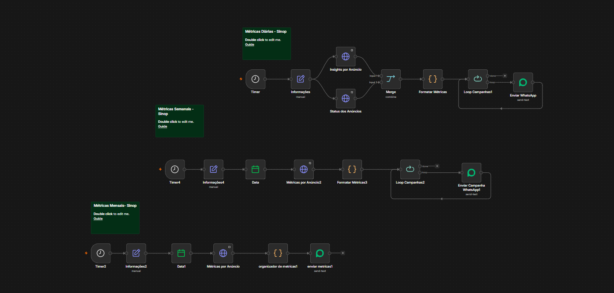
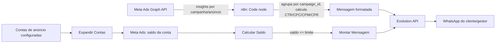

# 📊 Ads Campaign Report Automation

Automação em **n8n** que gera relatórios de desempenho de campanhas do **Meta Ads** (Facebook/Instagram) e envia direto para o **WhatsApp**, além de alertar sobre saldo baixo nas contas de anúncio — tudo sem intervenção manual.

Criado para eliminar o trabalho repetitivo de entrar no Gerenciador de Anúncios, montar relatório e mandar mensagem para o cliente todos os dias.



---

## 📈 Resultados em produção

Em uso por uma rede de revenda de veículos com **3 lojas** e **~R$ 15 mil/mês** em tráfego no Meta Ads.

| Antes | Depois |
|---|---|
| Gestor montava os relatórios numa plataforma paga de terceiros, com muito trabalho manual | Relatórios gerados e enviados no WhatsApp automaticamente |
| ~1 dia de trabalho por semana | ~0 h manuais |
| Assinatura de R$ 300/mês | Sem custo de licença (n8n + Evolution API) |

**Impacto:**
- ⏱️ ~8 h/semana economizadas (≈ 35 h/mês)
- 💸 R$ 300/mês a menos em assinatura (≈ R$ 3.600/ano)
- 🏪 3 lojas atendidas com relatórios diário, semanal e mensal
- 📨 ~150 execuções em produção desde [março/2026]

---

## ✨ O que essa automação faz

- **Relatórios automáticos** (diário, semanal e mensal) com as métricas certas para cada tipo de campanha — mensagens, vendas, leads, tráfego, engajamento, alcance/reconhecimento de marca.
- **Detecção automática do objetivo da campanha** (`optimization_goal`) para decidir qual métrica é o "resultado principal" e qual bloco de dados mostrar na mensagem — sem relatório genérico que não diz nada.
- **Ranking de anúncios**: dentro de cada campanha, lista os anúncios ativos ordenados por performance e destaca os pausados.
- **Mensagem pronta para WhatsApp**, formatada com emojis e Markdown, via **Evolution API**.
- **Alerta de saldo baixo**: verifica o saldo das contas de anúncio e dispara um aviso no WhatsApp quando o valor fica abaixo do limite configurado — evita campanha pausada por falta de saldo.

---

## 🧠 Por que esse projeto é interessante

O desafio real aqui não é "chamar uma API e mandar WhatsApp" — é que a **API do Meta Ads não retorna um relatório pronto**: ela retorna um mar de `action_type` genéricos (`onsite_conversion.messaging_conversation_started_7d`, `link_click`, `purchase`, `post_engagement`...) que variam conforme o objetivo da campanha.

Este projeto resolve isso com uma pequena "engine" de mapeamento:

```
optimization_goal (Meta Ads) → action_type relevante → label + bloco de métricas → mensagem final
```

- `MAPA_GOAL` traduz o objetivo da campanha no `action_type` que realmente importa.
- `LABEL_MAP` traduz esse `action_type` num rótulo amigável ("Leads", "Compras", "Conversas Iniciadas"...) e num "bloco" de métricas a exibir.
- Quando o objetivo não é reconhecido, existe um **fallback inteligente**: a automação tenta inferir o resultado mais relevante (mensagens > compras > tráfego > engajamento > impressões), então nunca quebra silenciosamente com uma campanha nova ou objetivo não mapeado.
- Isso torna a automação **extensível**: para suportar um novo tipo de campanha basta adicionar uma linha em cada mapa (documentado no topo do [weekly.js](weekly.js)).

---

## 🗂️ Estrutura

```
ads_campaign-report-automation/
├── workflow.n8n.json   # Workflow completo exportado do n8n (importável direto)
├── docs/
│   └── workflow-overview.png   # Screenshot do canvas do n8n (3 automações de relatório)
├── daily.js     # Relatório diário por campanha, com ranking de anúncios ativos/pausados
├── weekly.js    # Relatório semanal consolidado (mais documentado, v2.0)
├── monthly.js   # Relatório mensal com métricas de conversão (ROAS, custo por lead, etc.)
└── Low-budget-notify/
    ├── Expandir Contas      # Explode a lista de contas configuradas em 1 item por conta
    ├── Calcular Saldo       # Calcula saldo real e decide se dispara alerta
    └── Montar Mensagem      # Formata a mensagem de alerta de saldo baixo
```

> Os arquivos `.js` e os arquivos sem extensão em `Low-budget-notify/` correspondem a nós **Code** individuais, extraídos do workflow para leitura isolada. O `workflow.n8n.json` é o workflow completo e pode ser importado direto no n8n (`Import from File`).
>
> 🔒 **Sanitização:** o `workflow.n8n.json` publicado aqui teve token de acesso do Meta Ads, ID da conta de anúncio e ID de grupo/contato do WhatsApp substituídos por placeholders (`SEU_ACCESS_TOKEN_AQUI`, `act_XXXXXXXXXXXXXXX`, etc.). Substitua pelos seus próprios valores ao importar.

---

## ⚙️ Como funciona (arquitetura)



**Fluxo dos relatórios (daily/weekly/monthly):**
1. Trigger agendado no n8n (cron diário/semanal/mensal).
2. Busca de *insights* na Graph API do Meta Ads (nível campanha e nível anúncio).
3. Nó Code agrupa os dados por campanha, acumula métricas e calcula KPIs derivados (CTR, CPC, CPM, custo por resultado).
4. `getMetrica()` decide qual é o resultado principal com base no `optimization_goal`.
5. `buildMensagem()` monta o texto formatado para WhatsApp, incluindo ranking de anúncios.
6. Envio via Evolution API.

**Fluxo de alerta de saldo:**
1. Lista de contas configuradas é expandida em um item por conta.
2. Para cada conta, busca saldo/limite de gasto na API do Meta.
3. Compara saldo com o limite de alerta configurado.
4. Se abaixo do limite, monta e envia mensagem de alerta no WhatsApp.

---

## 🛠️ Tecnologias

- **[n8n](https://n8n.io/)** — orquestração do workflow (self-hosted ou cloud)
- **JavaScript (Node.js)** — lógica de transformação nos nós Code
- **[Meta Marketing API](https://developers.facebook.com/docs/marketing-apis/)** (Graph API) — dados de campanhas, anúncios e contas
- **[Evolution API](https://github.com/EvolutionAPI/evolution-api)** — envio de mensagens via WhatsApp

---

## 🚀 Como usar

**Opção rápida:** importe [workflow.n8n.json](workflow.n8n.json) direto no n8n (`Import from File`) e ajuste os placeholders de token/conta/WhatsApp pelos seus próprios valores.

**Montando do zero:**
1. Tenha uma instância do n8n rodando (cloud ou self-hosted).
2. Crie um workflow com:
   - Trigger `Cron` (diário, semanal ou mensal conforme o relatório desejado).
   - Nó HTTP Request (ou credencial nativa do Meta) para buscar `insights` da campanha/conta.
   - Nó **Code** com o conteúdo de [daily.js](daily.js), [weekly.js](weekly.js) ou [monthly.js](monthly.js).
   - Nó HTTP Request apontando para sua instância da Evolution API, usando o campo `mensagem`/`text` retornado.
3. Para o alerta de saldo, monte um segundo workflow com os três nós de [Low-budget-notify/](Low-budget-notify/), alimentados por uma lista de contas de anúncio (JSON com `id`, `nome`, `access_token`, `limite_alerta_reais`, `numero_whatsapp`, credenciais da Evolution API).

> ⚠️ Configure suas próprias credenciais do Meta Ads e da Evolution API diretamente no n8n.

---

## 📌 Status

Projeto em uso ativo — os relatórios diário, semanal e mensal e o alerta de saldo estão rodando em produção via n8n.

